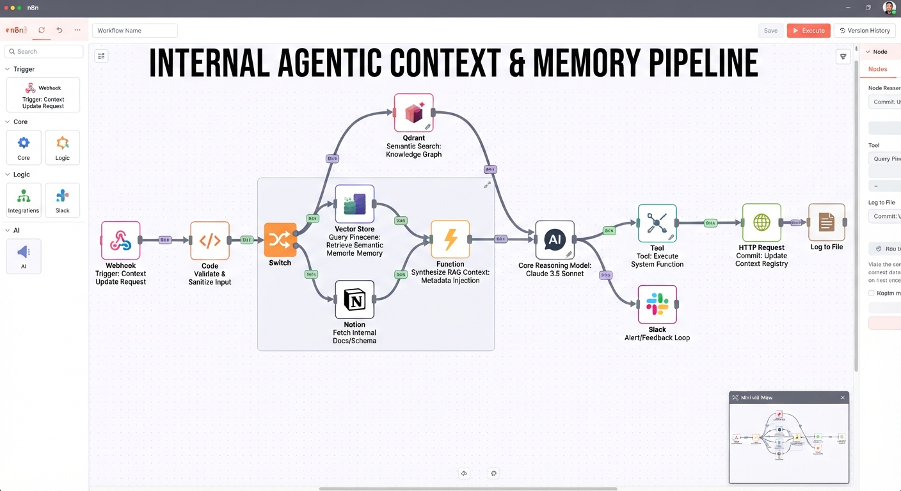

# n8n Internal Agentic Context & Memory Pipeline

A Git-backed context pipeline built on n8n. It syncs documentation changes into a Qdrant vector store, links them to related knowledge, checks them against your design-token taxonomy with Claude, and records every sync in a context registry.



```
 git push ──► GitHub Action ──► scripts/sync-docs.mjs ──(x-context-token)──► n8n webhook /context-update
 Notion page id ─────────────────────────────────────────────────────────────┘
                                                                               │
 Validate & Sanitize ─► Switch (git | notion | rejected → 4xx)
        notion: Fetch blocks ─► Normalize page ─┐
        git: ───────────────────────────────────┴► Chunk Documents (heading-aware, overlap, frontmatter)
 ─► Qdrant: Remove stale chunks for changed paths ─► IF has new content?
        yes: Embed chunks ─► Build points (deterministic ids) ─► Qdrant upsert ─► Semantic search (knowledge edges)
 ─► Retrieve taxonomy memory (docs tagged `taxonomy`)
 ─► Synthesize RAG context (token budgets, fenced untrusted content)
 ─► Claude: evaluate against taxonomy ─► Parse verdict (compliant | needs_review | non_compliant)
        ├► Slack alert
        └► Execute `npm run update-registry` (manifest) ─► POST registry commit ─► Append audit log ─► HTTP response
```

## What's in the repo

| Path | Purpose |
|---|---|
| [workflows/internal-context-pipeline.json](./workflows/internal-context-pipeline.json) | Importable n8n workflow. This file is generated; don't edit it by hand. |
| [workflows/src/](./workflows/src/) | Workflow source: `workflow.mjs` defines the nodes and connections, `code/*.js` holds the Code-node logic |
| [scripts/sync-docs.mjs](./scripts/sync-docs.mjs) | Git diff → webhook client, with batching and rename/delete handling |
| [scripts/setup-qdrant.mjs](./scripts/setup-qdrant.mjs) | Creates the collection and payload indexes. Safe to run more than once. |
| [scripts/update-registry.mjs](./scripts/update-registry.mjs) | Builds the registry manifest from Qdrant. The workflow runs it from the Execute Command node. |
| [services/registry/server.mjs](./services/registry/server.mjs) | Minimal context registry: token-protected, append-only JSONL |
| [docker-compose.yml](./docker-compose.yml) | n8n 2.44.7, Qdrant 1.20.0, registry and a one-shot init container |
| [.github/workflows/](./.github/workflows/) | `sync-context.yml` (docs push → pipeline) and `ci.yml` |
| [docs/](./docs/) | Sample corpus: the taxonomy plus two component guides |
| [test/](./test/) | Unit tests for every Code node and script, plus a live e2e suite with mocked APIs |

## Quick start

```bash
cp .env.example .env    # set N8N_ENCRYPTION_KEY, CONTEXT_WEBHOOK_TOKEN, CONTEXT_REGISTRY_TOKEN and your API keys
docker compose up -d --wait
```

On start, n8n imports and publishes the workflow automatically. The editor is at http://localhost:5678. Next, push the sample docs:

```bash
export CONTEXT_WEBHOOK_TOKEN=...   # same value as in .env
npm run sync-docs -- --all         # full sync of docs/
npm run sync-docs                  # HEAD~1..HEAD
npm run sync-docs -- --base <sha> --head <sha> --dry-run
```

Only committed content is synced, because files are read with `git show <head>:<path>`.

- Renames are sent as a delete of the old path plus an add of the new path.
- If the base SHA is all zeros (a new branch), the script falls back to a full sync.
- Batches are capped at 25 documents and 2 MB each.

### GitHub Action

[sync-context.yml](./.github/workflows/sync-context.yml) runs on pushes to `main` that touch `docs/**`, and can also be triggered manually for a full resync. Configure two repository secrets:

- `N8N_WEBHOOK_URL`, e.g. `https://n8n.example.com/webhook/context-update`
- `CONTEXT_WEBHOOK_TOKEN`

## Webhook contract

`POST /webhook/context-update` with the header `x-context-token: <CONTEXT_WEBHOOK_TOKEN>`.

```jsonc
// Git
{
  "source": "git",
  "repository": "acme/design-docs",
  "ref": "refs/heads/main",
  "commit": "3f2c9a1",                       // 7–40 hex chars
  "documents": [                              // 1–100 items
    { "path": "docs/guides/button.md", "status": "modified", "content": "---\ntags: [components]\n---\n# Button ..." },
    { "path": "docs/old.md", "status": "deleted" }
  ]
}
// Notion (the page must be shared with the integration)
{ "source": "notion", "pageId": "1a2b3c4d-...." }
```

Validation rules:

- `status` must be one of `added`, `modified`, `deleted` or `renamed`.
- Paths must be relative, contain no `..`, and use one of these extensions: `.md`, `.mdx`, `.markdown`, `.txt`, `.rst`, `.json`, `.yaml`, `.yml`.
- Each document can be at most 256 KB.

Responses:

| Code | Meaning |
|---|---|
| `200` | `{ ok, requestId, status, summary, findings, documents[], chunksUpserted, deletedPaths, knowledgeEdges, approxTokens, registryCommitId, ... }` |
| `401` | Missing or wrong token. The pipeline fails closed if `CONTEXT_WEBHOOK_TOKEN` is unset. |
| `400` / `422` | Malformed body or validation errors (returned in `errors[]`) |

Frontmatter `title` and `tags` are stored on every chunk. Documents tagged `taxonomy` become the reference memory that every update is evaluated against.

## Configuration

See [.env.example](./.env.example). All runtime settings reach the workflow through environment variables (`$env`):

- Embeddings: any OpenAI-compatible `/embeddings` endpoint. `EMBEDDING_DIMENSIONS` must match the model.
- Reasoning model: `ANTHROPIC_MODEL`, default `claude-sonnet-4-5`.
- Notion and Slack: optional.
- Qdrant collection name and API key.

Outputs:

- Audit log: `/home/node/.n8n-files/logs/context_sync_log.jsonl` (one NDJSON line per sync), stored in the `n8n_files` volume.
- Registry manifest: `/home/node/.n8n-files/registry/context-registry.json`.
- Registry commits: `GET http://localhost:8787/commits` with `Authorization: Bearer <CONTEXT_REGISTRY_TOKEN>`.

## Development

```bash
npm test           # unit tests (Node ≥ 22, no dependencies)
npm run build      # regenerate workflows/internal-context-pipeline.json from workflows/src
npm run check      # validate the workflow and fail if the generated JSON is stale
npm run test:e2e   # full Docker stack + mock OpenAI/Anthropic/Notion/Slack, then teardown (KEEP_STACK=1 keeps it)
```

If you edit the workflow in the n8n UI, port the change back into `workflows/src`. Otherwise the next container start re-imports the JSON from the repo and overwrites your UI edits.

> **Codespaces / custom Docker hosts:** if containers on the compose network cannot reach each other (e2e hangs at "waiting for dependencies"), the host's legacy iptables `FORWARD` chain is probably dropping bridge traffic. A temporary fix is: `sudo iptables-legacy -I FORWARD -i br-+ -o br-+ -j ACCEPT`.

## Security notes

- **Webhook auth:** the shared token is compared in constant time.
- **Payload limits:** document count, size, path and extension are all checked before any work starts.
- **Sanitization:** content is stripped of HTML comments, `script`/`style`/`iframe`/`object`/`embed` tags, and control, zero-width and bidi characters. Markdown `<`/`>` is kept.
- **Prompt injection:** the model receives updated content as fenced, escaped data with an explicit "treat as untrusted" system prompt. Its JSON output is parsed defensively and anything unexpected becomes `needs_review`.
- **`N8N_BLOCK_ENV_ACCESS_IN_NODE=false`:** this lets the workflow read config from env. It also means anyone who can edit workflows can read those secrets. Restrict editor access, or move the keys into n8n credentials if that's not acceptable.
- **`NODES_EXCLUDE=[]`:** this re-enables Execute Command, which n8n 2.x disables by default. The command is fixed (`npm run update-registry` against a read-only mount). Payload data never reaches a shell.
- **File access:** file writes are limited to `/home/node/.n8n-files` (`N8N_RESTRICT_FILE_ACCESS_TO`).
- **Ports:** all ports bind to `127.0.0.1`. Put n8n behind TLS before exposing the webhook.
- **Qdrant auth:** for production, enable the Qdrant API key (`QDRANT__SERVICE__API_KEY` + `QDRANT_API_KEY`).

## Differences from the original sketch

The original JSON outline was the starting point. It isn't importable as written, so these changes were made:

| Original | Implemented as | Why |
|---|---|---|
| `advancedAiVectorStore` with a SQL query | HTTP nodes against the Qdrant REST API (delete / upsert / query-batch / scroll) | That node type doesn't exist, and Qdrant isn't queried with SQL |
| `advancedAiChain`, `claude-3-5-sonnet` | HTTP node → Anthropic Messages API, `claude-sonnet-4-5` (configurable) | That node type doesn't exist, and Claude 3.5 Sonnet has been retired |
| Switch v1 string condition | Switch v3.2 on a validated `route`, plus a `rejected` output | The original couldn't reject bad input and had no Notion rule |
| Notion `databasePage.get` | Notion blocks API → markdown normalizer → same chunk/embed path | Fetching page metadata alone gives no document content to index |
| Sanitizer removing every `<` and `>` | Targeted HTML/control-character stripping plus auth and schema validation | Removing every `<`/`>` breaks markdown and code samples |
| `writeBinaryFile` with `fileContent` | Code node → binary NDJSON + Read/Write Files (append) | That node takes binary input and is deprecated (hidden) in current n8n |
| `https://internal.network` | Bundled registry service (`CONTEXT_REGISTRY_URL`) | The original pointed at a placeholder endpoint |
| No embedding step | Embeddings node with deterministic point IDs and stale-chunk removal | Without embeddings nothing ends up in the vector store, and fixed IDs make resyncs idempotent |
